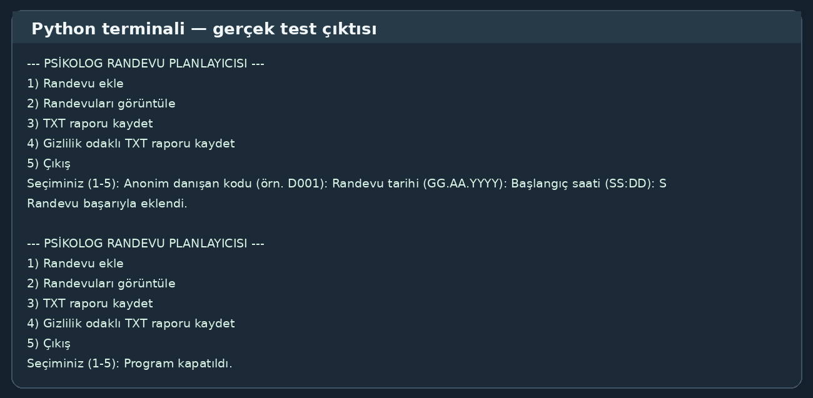
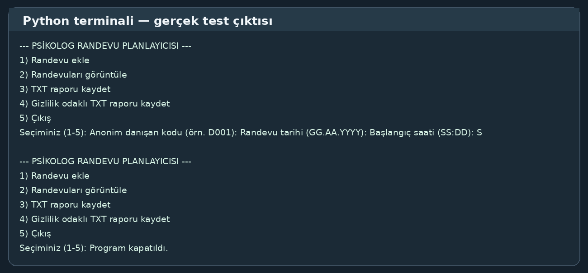
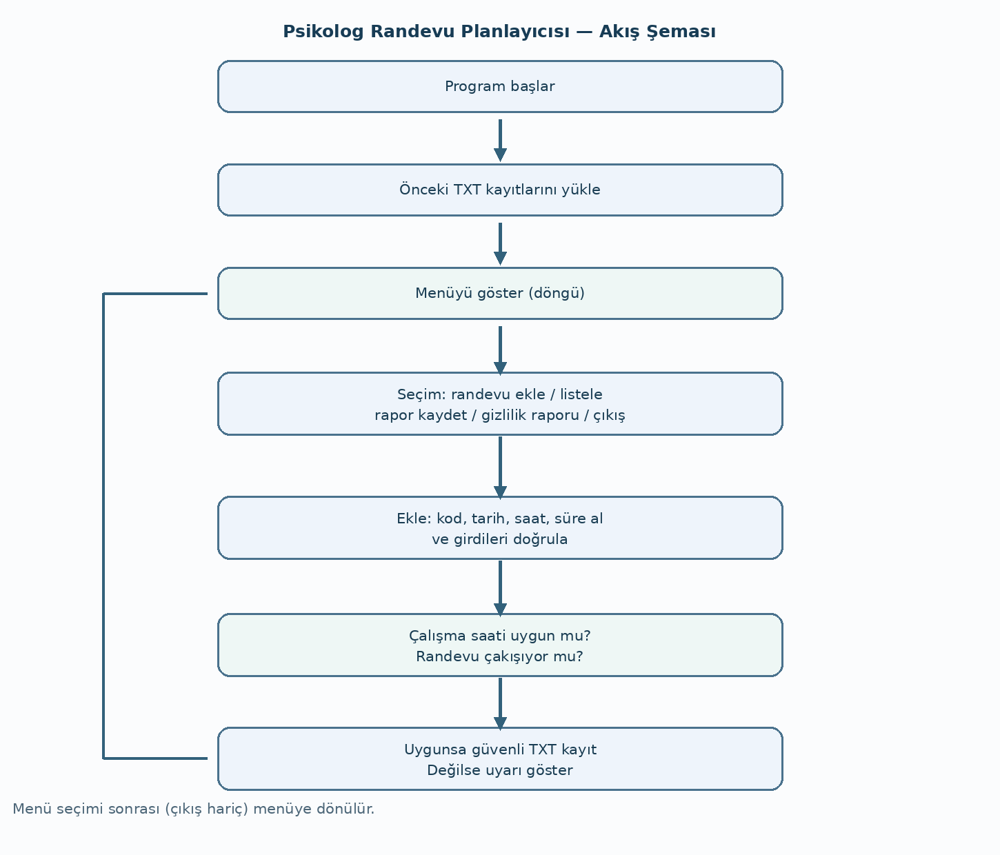

# Psikolog Seans ve Randevu Planlayıcısı

**GEP1316 – Kodlama Okuryazarlığı, Ara Değerlendirme Ödevi 1**  
**Öğrenci:** Beyza Azra Uzun | **Bölüm:** Psikoloji

Bu Python komut satırı uygulaması, bir psikoloğun örnek seanslarını planlamak için hazırlanmış öğrenci projesidir. **Gerçek danışan bilgisi kullanılmamalıdır.** Kodlar kimlikle eşleştirilebiliyorsa anonim değil takma adlı veridir; kayıt dosyaları şifreli değildir. Gerçek klinik kullanım için tasarlanmamıştır.

## Özellikler

- Danışan kodu, randevu tarihi, başlangıç saati ve seans süresi olmak üzere 4 girdi alır.
- Yanlış/boş girişlerde uyarı verir; geçersiz tarih ve saatleri reddeder.
- Geçmiş tarihlere ve **09:00–18:00** dışına randevu verilmesini önler.
- Aynı saat aralığındaki randevuların çakışmasını tespit eder.
- Menü döngüsü, `if/elif/else` karar yapıları, fonksiyonlar, liste ve sözlükler kullanır.
- `randevu_raporu.txt` dosyasına kaydeder; yeniden başladığında önceki kayıtları geri yükler.
- `gizlilik_odakli_rapor.txt` dosyasında danışan kodunu gizler.
- Ana kayıt için geçici dosya ve `os.replace` yöntemiyle güvenli kaydetme kullanır.

## Nasıl çalıştırılır?

Python 3 kurulu olan bir bilgisayarda veya Python çalıştırabilen uygun bir ortamda terminal açın:

```bash
python uygulama.py
```

Bazı cihazlarda `python3 uygulama.py` komutu gerekir. **Yalnızca Python standart kütüphanesi** kullanılmıştır; ek paket kurulmaz. iPad'de Python çalıştırmak için ayrı bir Python ortamı gerekir, ancak GitHub üzerinden kaynak kodu görüntülemek mümkündür.

Menü: `1` Randevu ekle, `2` Listele, `3` Normal TXT raporunu kaydet, `4` Gizlilik raporunu kaydet, `5` Çıkış. İlk randevuda gerçek isim yerine `D001` gibi hayalî bir kod kullanın.

## Çalışma mantığı ve dosyalar

- `uygulama.py`: Ana program.
- `randevu_raporu.txt`: Program çalıştırılınca oluşturulan/okunan ana kayıt.
- `gizlilik_odakli_rapor.txt`: Menüden istenince üretilen kodsuz paylaşım raporu.
- `PROMPTLAR.md`: Beş gerçek YZ etkileşimi ve öğrenci kararları.
- `gorseller/`: Akış şeması ve terminal test çıktılarından oluşturulmuş görseller.
- `TESTLER.md`: Gerçek otomatik test sonuçları.

**Not:** `randevu_raporu.txt` kayıt dosyasıdır; kopyalamadan silmeyin. Bozuk satır tespit edilirse program veri kaybını önlemek için durur. Gizlilik raporu, kayıt dosyasının yerine geçmez.

## Testler

Python 3 ile ayrı geçici klasörlerde **13 otomatik test** çalıştırıldı ve 13'ü de geçti. İki test randevu çakışmasını ve mesai sınırlarını; diğer testler hatalı girişleri, yeniden başlatmayı, gizlilik raporunu ve dosya kaydı güvenliğini kapsar. Ayrıntı: [TESTLER.md](TESTLER.md).

### Örnek terminal görüntüleri

**Normal randevu ekleme (gerçek terminal çıktısından oluşturulan görsel; fotoğraf değildir):**



**Mesai saati dışında randevu (gerçek terminal çıktısından oluşturulan görsel; fotoğraf değildir):**



### Akış şeması



## YZ kullanım beyanı

ChatGPT, kod geliştirme, gözden geçirme, test, hata ayıklama ve belge taslaklarında kullanıldı. Öğrenci geliştirme seçeneklerini ve beş promptun gerekçelerini konuşmada onayladı. Bu depoda kişisel/klinik veri bulunmamalıdır.

**Kaynak:** OpenAI. (2026). *ChatGPT* [Büyük dil modeli]. https://chatgpt.com
